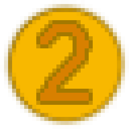
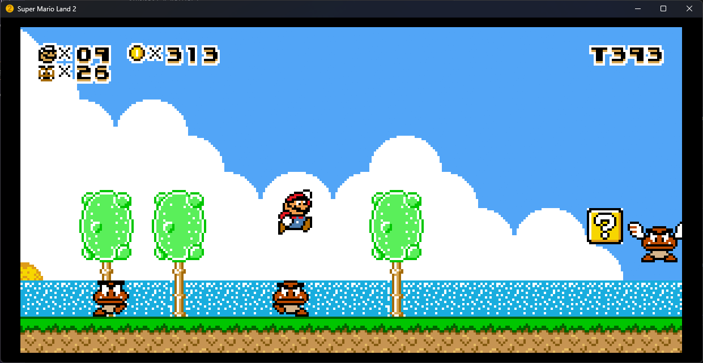
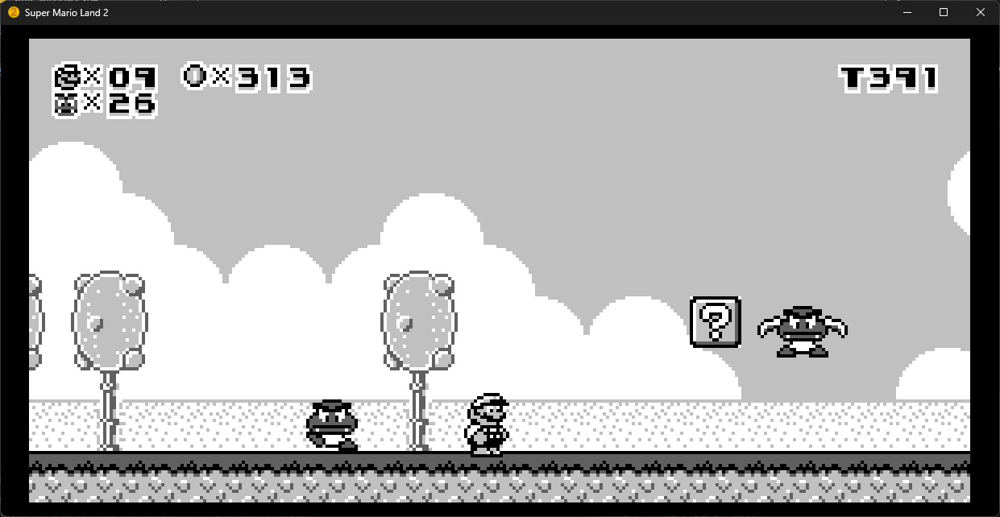
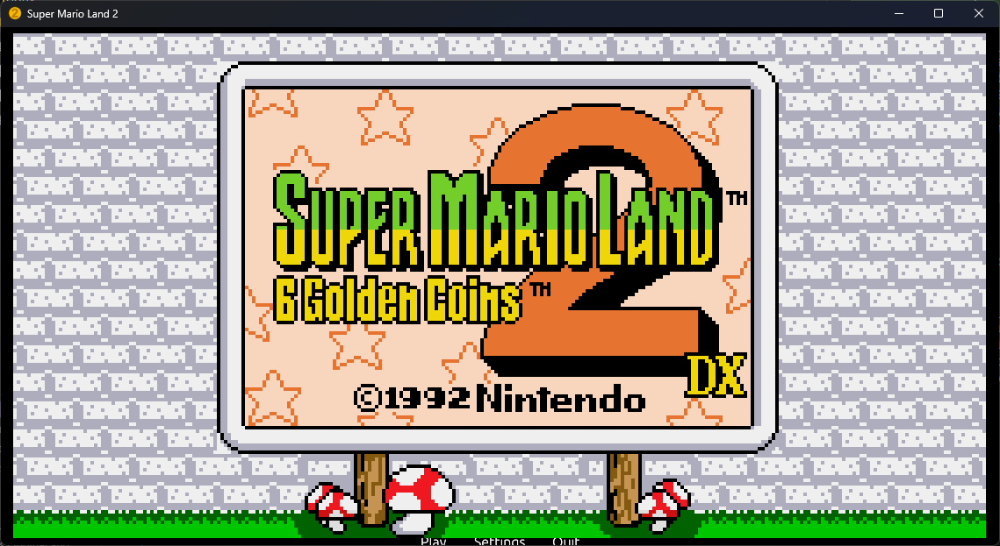
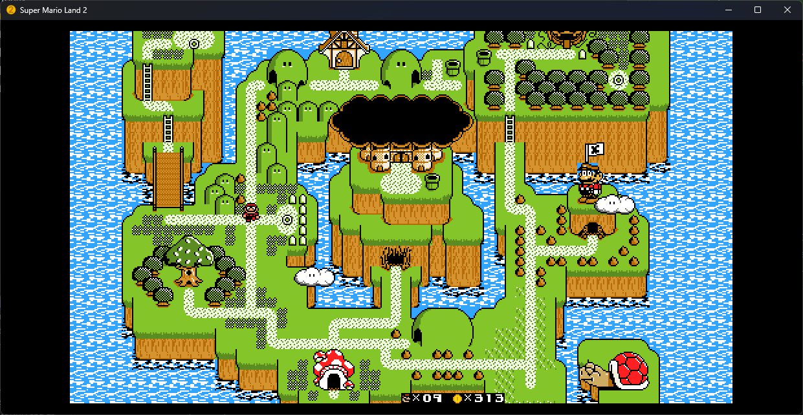
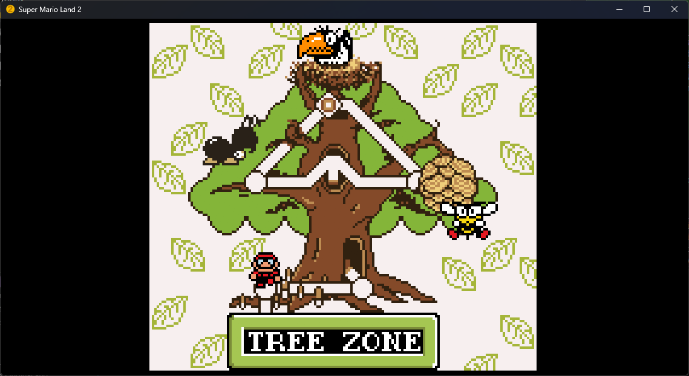
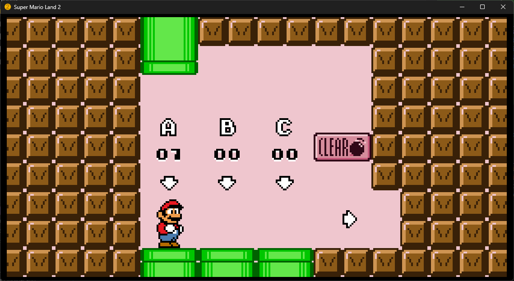

  

<h1 align="center">Six Golden Coins</h1>

  An enhanced desktop edition of <b>Super Mario Land 2: 6 Golden Coins</b>, rewritten in Rust.

  
  
  
  

  
  
   
  SML2DX colors (left) and the original Game Boy look (right), both widescreen.

  
  
   
  
  

## Features

- Widescreen: 16:9, 21:9, or your window's aspect ratio.
- Camera zoom-out presets up to 200%.
- Optional frame interpolation for high refresh rate displays.
- SML2DX graphics and colors, with Mario or Luigi.
- Game Boy, Pocket, Game Boy Color, and Super Game Boy display palettes when not in DX mode.

## Accuracy

This is a native port, not an emulator, and it does not aim to be perfectly
emulator accurate. Gameplay logic follows the original game's code, but expect
small differences from real hardware in timing and edge cases.

**Widescreen** and **Camera zoom** show more of each level than the Game Boy
screen did. Enemies off the original screen edge become active sooner, so some
enemy behavior and encounters will change. For the closest match to the
original game, set **Widescreen** to **Off** and **Camera zoom** to **100%**.

## Getting started

Release builds target **Windows x64**, **Linux x86_64**, and **macOS Apple
Silicon**. Download the asset for your platform from the
[latest release](https://github.com/patricksmill/sml2-rs/releases/latest):

| Platform | Asset | First run |
| --- | --- | --- |
| Linux x86_64 | `SixGoldenCoins-v<version>-linux-x86_64.AppImage` | `chmod +x` the file, then run it. If the AppImage cannot mount, run it with `--appimage-extract-and-run`. |
| Windows x64 | `SixGoldenCoins-v<version>-windows-x64.zip` | Unzip anywhere and run `sml2.exe`. SmartScreen may warn, since the build is unsigned. |
| macOS Apple Silicon | `SixGoldenCoins-v<version>-macos-arm64.zip` | Unzip and move `Six Golden Coins.app` to Applications. The build is unsigned; on first launch, right-click the app and choose **Open**. |

Each release also ships `SHA256SUMS.txt`, so you can check your download with
`sha256sum -c SHA256SUMS.txt` (Linux) or `shasum -a 256 -c SHA256SUMS.txt`
(macOS).

1. Launch the game and use **Settings → Game → Import ROM…** to select your own
   **Super Mario Land 2 UE v1.0** cartridge dump, then choose **Play**.
2. Check for a newer release any time under **Help → Check for Updates…**, or
   leave it to the once-a-day automatic check. Updates download, verify against
   the release's `SHA256SUMS.txt`, and restart the game in place.

Or [build locally](docs/desktop.md#build-and-run); local builds never check for
updates. See [Getting started](docs/Getting-Started.md) for platform setup
details.

## SML2DX

Import an **SML2DX v1.8.1** ROM or IPS patch through
**Settings → Game → Add DX ROM / IPS…**, then enable **DX Mode**.
Choose Mario or Luigi in **Settings → Mods**.

DX palette uploads don't yet follow the original's VBlank job order, so a
color change can land a frame off. See
[DX compatibility](docs/desktop.md#sml2dx-mode).

## Controls

| Action | Keyboard | Controller |
| --- | --- | --- |
| Move | Arrow keys | D-pad / left stick |
| Jump | Z / Space | Bottom face button |
| Run / fire | X / Shift | Left or right face button |
| Spin jump (in the air) | C | ZL / ZR (L2 / R2) |
| Start / confirm | Enter | Left stick click |
| Select | Backspace | Select / Back |
| Pause menu / resume | Escape | Start |
| Fullscreen | F11 | Settings menu |
| Cycle display palettes | F4 | Settings menu |
| Toggle top toolbar | F10 | Optional binding |

Change bindings in **Settings → Controls**. See the
[desktop guide](docs/desktop.md) for setup help and save locations.

## How it was made

Development used [patricksmill/marioland2](https://github.com/patricksmill/marioland2), forked from [Super Mario Land 2 disassembly](https://github.com/froggestspirit/marioland2) by froggestspirit, which rebuilds a byte-identical copy of the original ROM
with RGBDS. 

The disassembly served as the reference for porting:

- **Rewriting, not translating.** Each routine was read in the assembly and
  rewritten as native Rust with typed actors and shared behavior, rather than
  emulating the CPU or converting instructions line by line. The
  [porting guide](docs/idiomatic-rust-porting.md) describes the approach.
- **Bounded tickets.** `tools/handler_task.py` slices one object handler out of
  the disassembly, following its control flow, jump tables and bank switches,
  so each change covers a single handler or subsystem.
- **Byte-level tests.** Each ported routine has unit tests that set up game
  state, run the Rust code, and check the resulting bytes against what the
  assembly does. See [PORTING.md](PORTING.md).
- **Coverage tools.** Scripts in [`tools/`](tools/README.md) compare the
  disassembly's dispatch tables, animation IDs and level routes with the Rust
  code to show what is still missing.
- **Asset extraction.** For development, `sml2-extract` parses the
  disassembly's source files to find levels, graphics, music and object data
  in a verified original ROM. The desktop app's ROM import uses the locations
  found this way, so players don't need the disassembly.

The work also went back into the fork: object handlers, shared helpers and handler states identified while porting were named in the disassembly.

No code, ROM data or graphics from the disassembly are included in this
repository.

## Legal

Six Golden Coins is a fan-made port for playing a game you own. It ships **no
ROM data and no Nintendo assets**: every release contains only this project's
own code, and graphics, music and level data are derived on your machine from
your own cartridge dump.

- Bring your own **Super Mario Land 2: 6 Golden Coins (UE v1.0)** dump. The
  game checks the revision and refuses anything else; nothing is downloaded
  from Nintendo.
- The port is built on the [Super Mario Land 2
  disassembly](https://github.com/froggestspirit/marioland2) by froggestspirit
  and the [patricksmill/marioland2](https://github.com/patricksmill/marioland2)
  fork.
- This project is not affiliated with, endorsed by, or sponsored by Nintendo.
  Super Mario Land 2: 6 Golden Coins, Mario, Luigi and related characters are
  trademarks of Nintendo, and all rights in the original game belong to
  Nintendo.
- This project's own code and art are licensed under the [MIT License](LICENSE).
