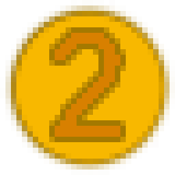
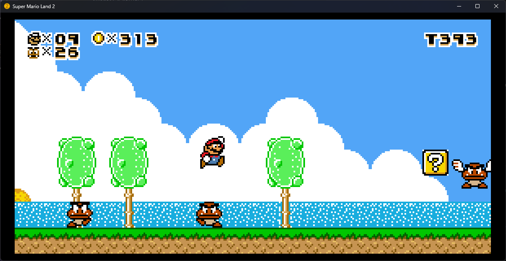
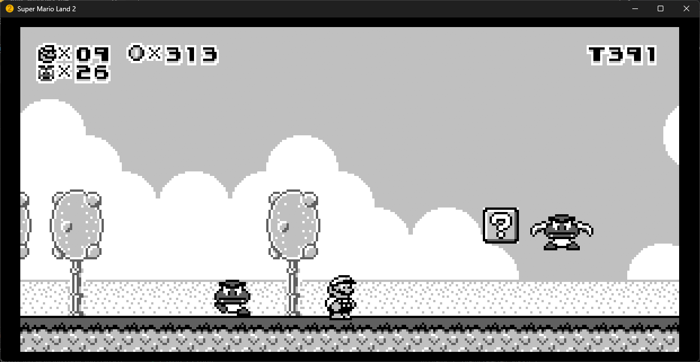
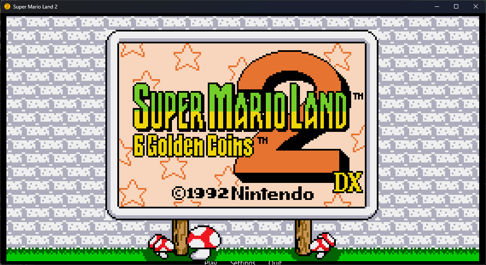
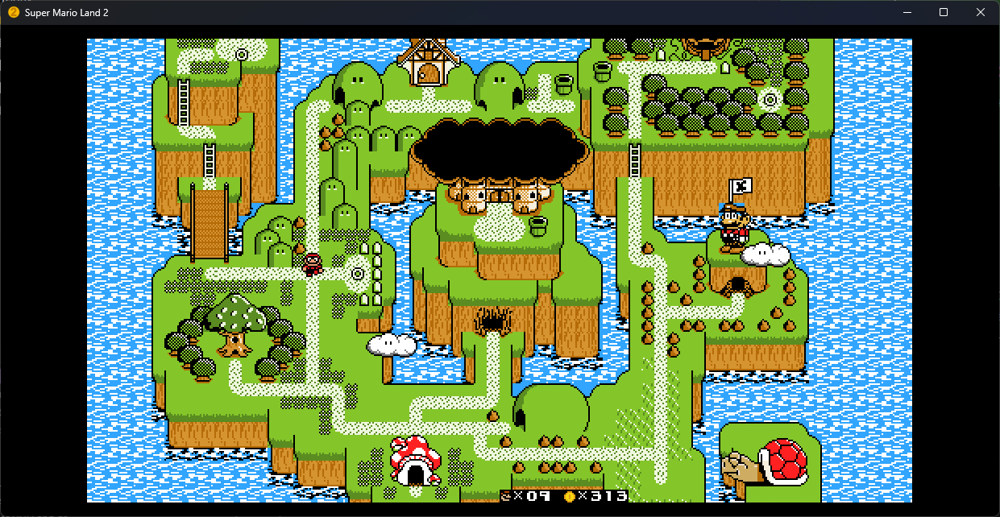
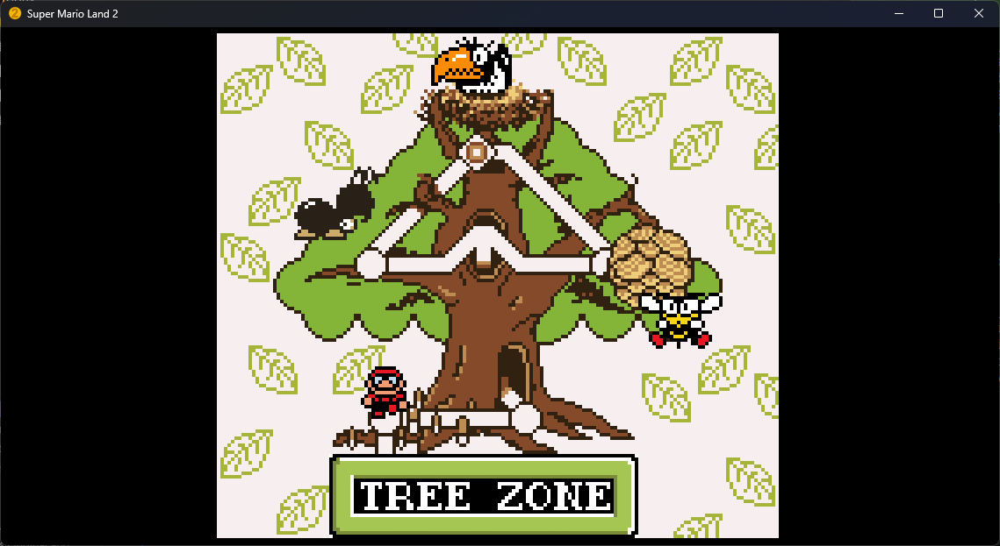
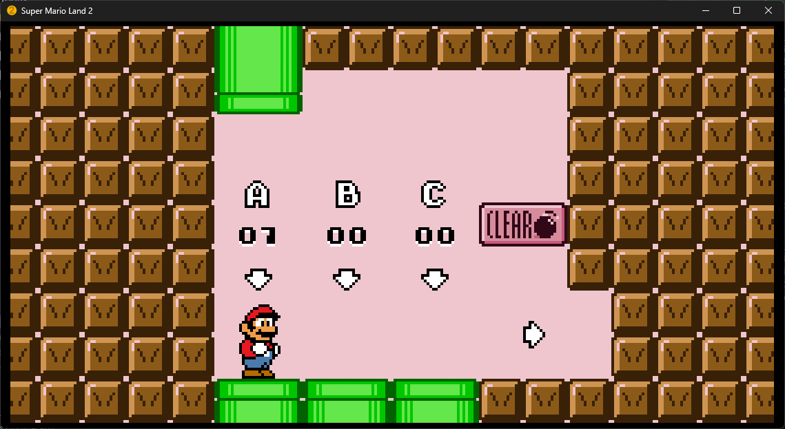

  

<h1 align="center">Six Golden Coins</h1>

  An enhanced desktop edition of <b>Super Mario Land 2: 6 Golden Coins</b>, rewritten in Rust.

  
  
   
  SML2DX colors (left) and the original Game Boy look (right), both widescreen.

  
  
   
  
  

## Features

- Widescreen: 16:9, 21:9, or your window's aspect ratio.
- Camera zoom-out presets up to 200%.
- Optional frame interpolation for high refresh rate displays.
- SML2DX graphics and colors, with Mario or Luigi.
- Game Boy, Pocket, Game Boy Color, and Super Game Boy display palettes when not in DX mode.

## Accuracy

This is a native port, not an emulator, and it does not aim to be perfectly
emulator accurate. Gameplay logic follows the original game's code, but expect
small differences from real hardware in timing and edge cases.

**Widescreen** and **Camera zoom** show more of each level than the Game Boy
screen did. Enemies off the original screen edge become active sooner, so some
enemy behavior and encounters will change. For the closest match to the
original game, set **Widescreen** to **Off** and **Camera zoom** to **100%**.

## Getting started

Release builds target **Windows x64**, **Linux x86_64**, and **macOS Apple
Silicon**. The first release is pending.

1. Download your platform's package from
   [Releases](https://github.com/patricksmill/sml2-rs/releases) when available,
   or [build locally](docs/desktop.md#build-and-run).
2. Launch it and use **Settings → Game → Import ROM…** to select your original
   **Super Mario Land 2 UE v1.0** ROM, then choose **Play**.

ROMs and imported game graphics are not included.

## SML2DX

Import an **SML2DX v1.8.1** ROM or IPS patch through
**Settings → Game → Add DX ROM / IPS…**, then enable **DX Mode**.
Choose Mario or Luigi in **Settings → Mods**.

DX palette uploads don't yet follow the original's VBlank job order, so a
color change can land a frame off. See
[DX compatibility](docs/desktop.md#sml2dx-mode).

## Controls

| Action | Keyboard | Controller |
| --- | --- | --- |
| Move | Arrow keys | D-pad / left stick |
| Jump | Z / Space | Bottom face button |
| Run / fire | X / Shift | Left or right face button |
| Start / confirm | Enter | Left stick click |
| Select | Backspace | Select / Back |
| Pause menu / resume | Escape | Start |
| Fullscreen | F11 | Settings menu |
| Cycle display palettes | F4 | Settings menu |

Change bindings in **Settings → Controls**. See the
[desktop guide](docs/desktop.md) for setup help and save locations.
